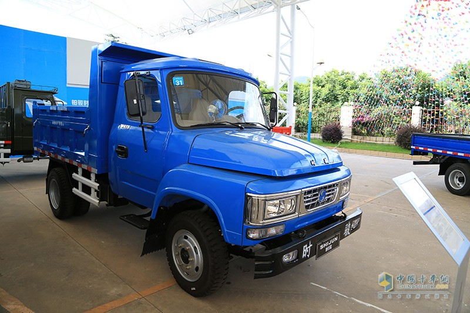
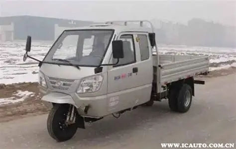

**小红书项目**

驾照报考篇

驾照的分类

驾照有分为A、B、C、D、E、F。其中我们的家用轿车一般靠C1,C2。C1为手动挡，C2为自动。C1可以直接驾驶C2(自动档)，C3(低俗载货汽车),C4(三轮汽车)准驾的车型。DEF是摩托车的牌照，D照可以驾驶EF，F是轻便摩托车。E照是驾驶二轮摩托车，D照是可以驾驶三轮摩托车。

C3:低俗载货汽车

C4：带方向盘的三轮汽车

报名

驾校报名需要问清楚的问题：

练车是一人一车还是几人一车。

交的费用包含哪些。一般费用有，体检费，考试报名费，考试模拟费，驾照工本制作费。

如果补考，补考费是否包含在模拟费或报名费里。

练车和考试的地方在那里，如果远的话包不包接送，如果接送的话，接送的流程是什么。

如果退学，退费是什么样子的。

踩坑点

被低价引流，各种理由收费。说如果挂科，还想再去练车，就会进行按节数收费。代预约科目二科目三的费用。其实可以自己预约

报名费比较高，说包含考试费用，考过了然后再退给我。后来才知道他这样做的目的是让我去考科目二。因为有些人，在科目二的时候会一直练，不去报名考试。所以就会采用如果报名考试了就把考试费退给你。但是科目三考完就不退了。

一般的报名费用不包含模拟费用。对模拟没有概念，教练说模拟以后如果挂科的话，会退报名费，下次考试还可以接着模拟，被忽悠了。刚开始不想模拟，教练就很生气，练车也不好好教。后知后觉才知道，教练是会吃回扣的。对于模拟，报一个中档的模拟也差不多，越高档，回扣越多。实际上高档和中档的区别是高档练习两个小时，如果补考的话高档大多是免报名考试费的。中档就是会让你模拟一两次合格就结束。

有一些考场可能有卡过关率的情况。考完以后，看到考场会外面记录哪些人过了，哪些人没过。还会算通过率。所以最好是早上早点去模拟，早点考试，下午的话，有些考场的车容易熄火。熄火主要针对的是手动挡车型。

技巧

对于科目一：可以下载驾照宝典，就一直模拟考试刷题，连续三次90分以上基本就能过。

科目二和科目三：就照着教练说的做就好，不要想要练得多会，能过拿驾照就可以。因为车的技术是实战出来的，考试的项目非常基础，要去实践多开车才会熟练起来。一般自己开车的里程数在两三千公里基本上就会了，而应付考试教练还是比较有经验。

尽量不要选择秋冬季节和天气不太好的时候去考科目二和科目三。因为有些时候被安排在下午三四点考试的话，可能视线不太好，影响很大。反过来讲就是尽量选择夏天去报名考驾照。

驾校报名的一些费用，你是可以和别人谈的，尽量让他们包含多一些费用。多对比几家驾校，好好的谈谈。

一般C2要比C1贵一些，所有的费用加起来最好不要超过四千五。虽然有一些说报名费只要2000左右甚至是更低的价格，如果没有清楚所有的花费的话，实际花费下来会达到三千以上甚至更贵。因为模拟费最贵的，科目二和科目三在1500左右，加上考试报名费在560左右。所以一定要问清楚价格的包含，不然差距会非常大。

如果时间比较多，不怕麻烦的话，尽量选择C1。因为C1是手动挡，会让你更了解车原始的运行逻辑。当然时间比较少，练车都没什么时间，就选择C2。C2基本上已经可以满足日常的需求。因为C2相对比较简单，现在的车也基本都是自动档。科目二和科目三都少了几个比较难的项目。

科目二，科目三预约考试的时候选择上午考试。选择上午考试可以下午考。预约下午的话，就只能下午考了。

如果签合同，一定要让他给你讲，自己再看看，不要自己看，很容易看漏。他给你讲就有义务给你讲明白。如果不放心，他讲的时候可以偷偷录音，万一维权有证据。

租车篇

遇到一列租车被坑案件，事情发生在2024年8月份，租车外出。原本是租一俩宝来。当在zfb下单后，租车商打电话说没车了，给我们换成速腾。取车的时，出租商要求买保险，然后被拒绝了。因为在之前的租车的经验来看，其实并不需。但是问题就在于，把车开到目的地的时候，发现后备箱那里被钉子一样的给刮了，以及驾驶位的叶子板也被蹭了。调了监控也看到来的时候就有了。回看了之前的照片，发现他们上传平台的照片一点痕迹都没有。当事人都打算修车了，回看了一下消息，找到了前一天晚上8点取车，不经意拍了一张发给朋友告诉他已经取到车了，才发现那个后备箱的小剐蹭已经存在。就知道可能有上当了。所以当还车的时候，就开始一顿撕扯，晚上8点换车，吵到了11点过。最后的结局商家还是算了。后来我们总结了这件事情。1.可能就是换一俩有问题的车，然后骗保险。2. 如果我们没有租车的经验，可能给他修车，或者是陪他的钱。

租车公司真的就想法设法的要让你掏钱。大家要小心呀~。

介绍汽车的时候再介绍。

自动档的车主要有，AT变速箱，有双离合，CVT，AMT变速箱。AT和CVT更好开一些，不容易有顿挫感。双离合要传动要高效，所以要省油一些，但是容易产生顿挫。什么是顿挫感，发动机的转速和档位不匹配，但是变速箱不知道是换挡还是降档，就有一种拖拉感，可以用一定教法去解决。双离合又分为干湿和湿式双离合。干式双离合依靠的是分冷散热，湿式双离合是有液油降温的。干式和湿式那个好？厂家的设计还是比较合理的，干式成本会更低。一般对于低扭矩的，干式要经济一些。实际上，如果开双离合自动档的车，在低速的时候，刹车其实可以按照离合的逻辑去压速度，会减少很多顿挫(应该放在驾驶经验上讲)

ECT有一个坑，授权取消。
